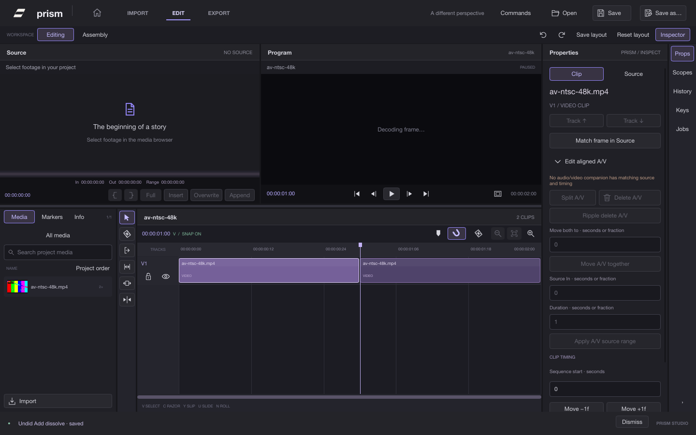

# Prism

Prism is a programmable video editor: every edit is a validated command that
the desktop app, CLI, scripts, and recipes can share. The goal is a dependable
editor for finishing real videos—not a visual clone of an existing NLE—with
exact timeline math, inspectable automation, safe project persistence, and
preview/export semantics that converge on one pipeline.

> **Alpha software:** the editing foundation works, but multitrack sequence
> export, native mixed-audio playback, titles, and rendered effects are still in
> development. See the [feature status](docs/FEATURE_STATUS.md) for evidence and
> current limits.



## Why Prism

- Edit conventionally in a native desktop timeline.
- Automate the same operations with Python, JavaScript, TypeScript, or recipes.
- Keep mutations behind one typed command engine with validation and undo/redo.
- Preserve exact rational time and atomic, versioned project files.
- Build toward matching preview and export behavior instead of parallel systems.

The proof workflow is intentionally practical: take a folder of podcast or
talking-head clips, apply ordered trims and dissolves, mix the audio, and export
an MP4 through a reproducible recipe.

## Try the current build

Install Rust 1.94.1 plus `rustfmt` and Clippy. Media workflows also require a
compatible local FFmpeg installation; Prism does not yet make a production codec
distribution claim.

```sh
cargo run -p prism-studio
```

For automation and headless workflows, see the [CLI command
reference](docs/CLI.md), [scripting API](docs/SCRIPTING_API.md), and
[native workspace guide](docs/development/NATIVE_WORKSPACE.md).

## Demo

Demo video coming soon. The planned walkthrough will cover import, timeline
editing, save/reopen, undo/redo, scripted edits, and synchronized MP4 export.

## Project status

Prism is under active development and is not production ready. The current
roadmap prioritizes complete sequence export, the wedge recipe, maintainable
module boundaries, visual editing features, editing semantics, and native audio
before expanding the feature surface. Architecture and acceptance evidence live
in [docs](docs/), with performance numbers in
[PERFORMANCE_BASELINES.md](docs/PERFORMANCE_BASELINES.md).

Licensed under Apache-2.0.
