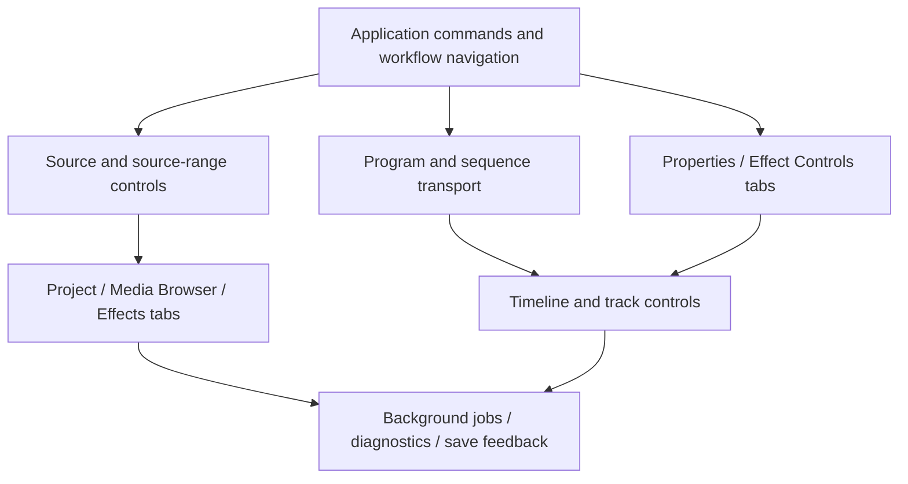

# Premiere interface and functionality reference for Prism

Research date: 13 November 2026. Purpose: guide Prism interface and workflow development.

## Scope and evidence

This is a broad map of Premiere's built-in interface, its principal panel families, editing operations, and the systems those controls depend on. It is not a claim to enumerate every effect parameter, codec option, third-party extension, or version-specific menu entry. Adobe's documentation and release notes are the primary references. The four user-supplied screenshots provide the visual baseline; local Prism source provides the implementation comparison. No installed Premiere instance was operated during this investigation.

The screenshots identify **Premiere Pro 2023**. Current Adobe documentation includes **Premiere 27.0**, released in November 2026. Keep the classic interface and current additions distinct. Availability also depends on platform, version, account, extensions, and media capabilities. Adobe's Help pages are not all updated together: older Lumetri documentation still exists alongside the new Color Mode documentation. [Adobe release notes](https://helpx.adobe.com/premiere/desktop/whats-new/release-notes.html).

## 1. Read the supplied screenshots

| Reference | What is visible | What it teaches us |
|---|---|---|
| Image 1: Edit | Application/menu bars; Import/Edit/Export navigation; Source/Effect Controls/Scopes/mixer tabs; Program and Reference tabs; Project/Media Browser/Libraries; vertical Tools; Timeline; Audio Meters; a narrow right-side panel stack | Editing uses docked groups, tabbed alternatives, and persistent monitor/timeline relationships. The empty state is a legitimate working state. |
| Image 2: Home | New Project, Open Project, Home, recent-project list, filter, name/date/size/kind columns | Home is a project entry surface rather than an editing workspace. |
| Image 3: Export | Source/destination area; output settings; preview; source/output summaries; export and Media Encoder actions | Export is a separate task with validation, settings, preview, and destination selection. No sequence means unavailable export controls. |
| Image 4: Import | Favorites and local locations; breadcrumb navigation; thumbnail media grid; view/search controls; copy/bin/sequence/transcription settings; selection feedback | Import separates choosing media, configuring ingest, and committing the selection. Selecting files need not immediately place them in the edit. |

Truncated labels in the right edge of Image 1 do not establish a complete list of available panels. We should not infer missing capabilities from that empty workspace.

## 2. Interface hierarchy

Premiere has several different levels of navigation:

- **Home**: project entry, recent work, learning content.
- **Import / Edit / Export**: major workflow surfaces in the screenshot generation.
- **Workspaces**: saved arrangements within the application, tuned to an editing task.
- **Panels**: functional surfaces such as Project, Timeline, or Effect Controls.
- **Panel groups**: multiple panels sharing a tabbed or stacked region.
- **Panel menus and settings**: options local to a particular panel.
- **Dialogs and preferences**: configuration or transactions such as sequence settings and keyboard mapping.

A workspace changes the arrangement of panels; it does not create a separate copy of the edit. Typical task layouts include Assembly, Editing, Effects, Color, Audio, Captions/Graphics, and review-oriented arrangements. Names and supplied presets vary with release. [Workspace overview](https://helpx.adobe.com/premiere/desktop/get-started/tour-the-workspace/what-are-workspaces.html).

Panels can be grouped as tabs, docked beside one another, undocked into floating windows, and placed on additional displays. Drop zones distinguish grouping from docking. [Docking and grouping](https://helpx.adobe.com/premiere/desktop/get-started/tour-the-workspace/dock-group-undock-panels.html).

Dividers resize neighboring groups; tabs bring panels forward. The Window menu reopens panels. [Panel customization](https://helpx.adobe.com/premiere/desktop/get-started/tour-the-workspace/customize-panels.html). Custom arrangements can be saved and reset. [Workspace persistence](https://helpx.adobe.com/premiere/desktop/get-started/tour-the-workspace/change-create-reset-workspaces.html).

### Menus, dialogs, and preferences

The screenshot menu bar is another part of the interface. These are command families, not additional dockable panels. The following is a functional grouping for Prism based on the visible menus and documented workflows; exact entries vary by release and operating system.

| Menu family | Responsibilities to accommodate |
|---|---|
| File | Project creation/open/save, import, project management and delivery |
| Edit | Undo/redo, clipboard edits and keyboard configuration; preferences placement differs by platform |
| Clip | Operations on source or timeline clips, including interpretation, speed and synchronization workflows |
| Sequence | Sequence settings, tracks, preview rendering and sequence-wide operations |
| Markers | Timed annotations and In/Out management |
| Graphics and Titles | Graphic/text authoring and management |
| View | Presentation and viewing options |
| Window | Open panels and choose/manage workspaces |
| Help | Learning, documentation and troubleshooting |

Dialog families include New Project, Sequence Settings, Speed/Duration, media relinking, proxy configuration, keyboard shortcuts, project management and Export Settings. Avoid presenting every configuration dialog as a permanent panel. [Adobe's workflow reference](https://helpx.adobe.com/premiere/desktop.html).

Application preferences control behavior beyond one clip or panel. Relevant groups include appearance, audio/devices, autosave, collaboration, color, graphics, labels, media/cache, memory, playback, timeline and trimming. These need a coherent settings surface in Prism rather than miscellaneous switches scattered through the edit workspace. [Preferences overview](https://helpx.adobe.com/premiere/desktop/get-started/preferences-and-settings/preferences-overview.html).

## 3. Panel inventory

Rows below describe panel families and specialized views, not a promise that every row appears as an independent Window-menu entry in every version.

### Media, organization, and inspection

| Panel / surface | Purpose | Principal controls and behaviors |
|---|---|---|
| Project | Organize assets already included in a project | List, Icon, and Freeform views; sortable metadata columns; thumbnail size; hover scrub; bins; New Item; automate assets into a sequence. |
| Bin panels / bin windows | Work within subsets of project assets | Open nested organization independently while retaining project relationships. |
| Media Browser | Discover media on storage before importing | Folder navigation, favorites, filename/type filters, thumbnails, hover preview, Source Monitor preview, import selected items. |
| Metadata | Inspect and edit descriptive information | File-based XMP and project-specific fields; configurable displayed schemas; clip names, notes, and timecode. |
| Info | Read compact technical and temporal information | Dimensions, frame rate, audio properties, selected ranges, and timecodes of items under the playhead. |
| Libraries | Reuse Creative Cloud assets | Shared assets across projects, signed-in computers, and supported Adobe apps. |
| Search — newer | Search beyond filenames | Visual media intelligence alongside transcript and metadata results; matching clip ranges can open in Source or enter a sequence. |
| Sequence Index — newer | Inspect a sequence as a searchable table | Filter clips, offline items, effects, transitions, and flash frames; jump to entries; export CSV. |

Sources: [Project views](https://helpx.adobe.com/premiere/desktop/get-started/customize-the-project-panel/customization-options-for-the-project-panel.html), [Media Browser](https://helpx.adobe.com/ph_fil/premiere-pro/how-to/import-with-media-browser.html), [Metadata](https://helpx.adobe.com/premiere/desktop/organize-media/edit-metadata/view-clip-data-in-the-metadata-panel.html), [Info](https://helpx.adobe.com/premiere/desktop/get-started/tour-the-workspace/clip-details-in-the-info-panel.html), [Libraries](https://helpx.adobe.com/premiere/desktop/collaborate-with-others/collaborate-using-creative-cloud-libraries/about-creative-cloud-libraries.html), [Search](https://helpx.adobe.com/premiere/desktop/organize-media/file-organization/media-intelligence-and-search-panel.html), [Sequence Index](https://helpx.adobe.com/premiere/desktop/organize-media/file-organization/navigate-timelines-with-sequence-index.html).

**Important distinction:** Project media is already registered in the project; Media Browser content is being discovered on disk. A filename filter is not equivalent to semantic media search. Prism currently combines a project-media list with a native file picker; it does not yet have a true Media Browser.

### Viewing and editing

| Panel / surface | Purpose | Principal controls and behaviors |
|---|---|---|
| Source Monitor | Prepare one source asset | Playback/scrub, source timecode, In/Out range, clip markers, separate audio/video drag, insert/overwrite, frame export. |
| Program Monitor | Inspect the assembled active sequence | Timeline-linked playhead, transport, sequence In/Out, markers, resolution and zoom, still export, lift/extract. |
| Reference Monitor — classic | Keep an additional sequence reference | Independent reference frame or ganged viewing; visible as a tab in the supplied screenshot. Treat its exact modern availability as version-dependent. |
| Timeline | Construct and refine sequences | Video/audio/caption tracks, clip editing, selections, ruler/playhead, zoom and scrolling, markers, transitions, keyframe display, track controls. |
| Tools | Choose pointer behavior | Selection, track selection, trimming families, Razor, Slip/Slide, Pen, shape/text, hand navigation, and newer specialized tools. |
| Trim mode / trim view | Refine an edit point precisely | Specialized trimming interaction rather than a separate project or sequence. |
| Multicam view | Switch among synchronized cameras | Camera-angle monitoring and cutting within the sequence workflow. |
| Timecode | Maintain readable timing readouts | Sequence/source values, duration and remaining-time displays, configurable lines, compact/full views, presets. |
| Markers | Navigate and annotate time | Clip/sequence marker lists, comments, properties, source-versus-sequence timing context. |

Sources: [Monitors](https://helpx.adobe.com/premiere/desktop/get-started/source-and-program-monitor-adjustments/about-source-monitor-and-program-monitor.html), [timeline fundamentals](https://helpx.adobe.com/ph_fil/premiere-pro/how-to/work-explore-panels.html), [timeline navigation](https://helpx.adobe.com/premiere/desktop/edit-projects/change-clip-sequence/navigation-controls-in-the-timeline.html), [Tools](https://helpx.adobe.com/premiere/desktop/get-started/tour-the-workspace/tools-panel-and-options-panel.html), [multicam](https://helpx.adobe.com/premiere/desktop/edit-projects/set-up-multi-camera-sequences-for-editing/create-a-multi-camera-source-sequence.html), [Timecode](https://helpx.adobe.com/premiere/desktop/organize-media/apply-labeling/timecode-display-options.html), [Markers](https://helpx.adobe.com/premiere/desktop/organize-media/apply-labeling/overview-of-markers.html). Historical Reference Monitor behavior is documented in [Adobe's archived manual](https://helpx.adobe.com/archive/en/premiere-pro/cc/2015/premiere_pro_reference.pdf); this is historical evidence, not confirmation for 27.0.

**Source and Program are separate contexts.** Selecting source footage must not silently replace the active sequence. Their playheads are normally independent; explicit ganging links their movement. [Monitor ganging](https://helpx.adobe.com/premiere/desktop/get-started/source-and-program-monitor-adjustments/gang-source-and-program-monitor.html).

### Effects, properties, color, and graphics

| Panel / surface | Purpose | Principal controls and behaviors |
|---|---|---|
| Effects | Find things to apply | Video/audio effects and transitions, presets, search, organization; current releases add animated previews and supported previews on footage. |
| Effect Controls | Edit effects on the selected clip | Motion, Opacity, Time Remapping, Volume, applied-effect parameters, keyframe timeline, value/velocity graphs, property filtering. |
| Properties — newer | Common controls appropriate to selection | Video transforms, audio controls, text/graphics/caption styling, shared multi-selection settings; 27.0 adds effect/mask cards. |
| Lumetri Color — classic | Correct and style images | Basic Correction, Creative, Curves, Color Wheels/Match, HSL Secondary, Vignette in the established workflow. |
| Lumetri Scopes — classic | Measure color and brightness | Waveform, RGB parade, vectorscope, histogram; this is measurement, not a grading control. |
| Essential Graphics — 2023 generation | Browse and edit graphics | Template browsing and text/shape/graphic customization in the classic arrangement. |
| Graphics Templates — newer | Find and manage MOGRTs | Browse/install templates and add them to sequences; customize supported template properties separately. |
| Text | Work with language and titles | Transcript editing, caption operations, and graphic-text management in the relevant tabs/workflows. |
| Color Mode surfaces — 27.0 | Dedicated modern grading environment | Clip Grid, Color Controls, Color Monitor, comparison tools and Video Scopes; clip/group/sequence grading operations. |

Sources: [Effects](https://helpx.adobe.com/premiere/desktop/add-video-effects/types-of-effects/about-effects-and-effects-panel.html), [Effect Controls](https://helpx.adobe.com/premiere/desktop/add-video-effects/apply-video-effects/about-effect-controls-panel.html), [Properties](https://helpx.adobe.com/ca/premiere/desktop/add-text-images/stylize-text/about-properties-panel.html), [classic grading](https://helpx.adobe.com/premiere/desktop/correct-color/color-correction-fundamentals/about-color-grading.html), [scopes](https://helpx.adobe.com/premiere/desktop/correct-color/add-color-effects/available-lumetri-scopes.html), [graphics migration](https://helpx.adobe.com/premiere/desktop/add-text-images/use-motion-graphics-templates/where-do-i-get-motion-graphics-templates.html), [Text-Based Editing](https://helpx.adobe.com/premiere/desktop/edit-projects/edit-video-using-text-based-editing/overview-of-text-based-editing.html), [Color Mode](https://helpx.adobe.com/premiere/desktop/correct-color/color-mode-fundamentals/color-mode-basics.html).

Do not confuse the **Effects browser** with the **Effect Controls inspector**. One chooses an operation; the other edits an applied instance. A Properties panel can accelerate common work while retaining detailed controls elsewhere.

### Audio

| Panel / surface | Purpose | Principal controls and behaviors |
|---|---|---|
| Audio Clip Mixer | Adjust individual clips | Clip-level volume and pan for clips encountered on tracks; distinct from track-wide mixing. |
| Audio Track Mixer | Mix the sequence's tracks | Track faders/pan, effects, sends, submix routing, automation, and recording; channels correspond to actual timeline tracks. |
| Essential Sound | Apply task-oriented audio adjustments | Dialogue, Music, SFX, Ambience classifications; loudness, repair, clarity, reverb and presets; associated enhancement/ducking workflows. |
| Audio Meters | Observe actual signal levels | Per-channel activity, clipping feedback, and level monitoring during playback. |
| Loudness Meter effect/editor | Measure delivery loudness | Momentary, short-term, integrated values and loudness range; measurement does not itself change gain. |

Sources: [audio concepts](https://helpx.adobe.com/premiere/desktop/add-audio-effects/basic-audio-editing/audio-editing-concepts.html), [Track Mixer](https://helpx.adobe.com/premiere/desktop/add-audio-effects/advanced-audio-techniques/about-audio-track-mixer.html), [Essential Sound](https://helpx.adobe.com/premiere/desktop/add-audio-effects/adjust-volume-and-levels/audio-editing-with-essential-sound-panel.html), [Audio Meters](https://helpx.adobe.com/premiere/desktop/add-audio-effects/adjust-volume-and-levels/monitor-volume-levels.html), [Loudness Meter](https://helpx.adobe.com/premiere/desktop/add-audio-effects/apply-audio-effects/measure-the-loudness-of-your-track.html).

A static waveform is source-derived information; an audio meter is a changing signal measurement. Neither should be decorative animation in Prism.

### Project management, review, diagnostics, and extensions

| Panel / surface | Purpose | Principal controls and behaviors |
|---|---|---|
| History | Inspect and revisit editing actions | Session undo/redo states; reopening a project does not restore the previous session's action history. |
| Events | Diagnose problems | Warnings, errors and information events, including issues from plug-ins. |
| Progress / task dashboard | Observe background activity | For example, media-intelligence analysis reports progress while editing remains available. Exact task coverage varies. |
| Production | Manage related projects | Multi-project organization, shared references and project locking in shared-storage workflows. |
| Frame.io | Review and exchange feedback | Media/version management, sharing for review and comments; distinguish Legacy and V4 integrations. |
| Learn / learning content | Guided onboarding | Tutorials and contextual learning surfaces; placement varies. |
| AI Assistant — 27.0 | Request project operations conversationally | Organizing footage, rough assemblies and other supported actions with project context. |
| Generative media surfaces — newer | Generate/extend material | Timeline-connected video/image/audio generation and extension workflows, subject to release and service availability. |
| Third-party extension panels | Host additional workflows | Installed integrations add their own interfaces and dependencies; these cannot be a fixed built-in inventory. |

Sources: [History](https://helpx.adobe.com/premiere/desktop/edit-projects/correct-mistakes/view-or-make-changes-in-the-history-panel.html), [Events](https://helpx.adobe.com/premiere/desktop/edit-projects/correct-mistakes/view-warnings-errors-and-information-events.html), [background analysis](https://helpx.adobe.com/premiere/desktop/organize-media/file-organization/media-intelligence-and-search-panel.html), [Productions](https://helpx.adobe.com/premiere/desktop/collaborate-with-others/collaborate-using-productions/about-productions.html), [Frame.io](https://helpx.adobe.com/premiere/desktop/collaborate-with-others/share-for-review-using-frame-io/about-frameio.html), [learning/workspaces](https://helpx.adobe.com/premiere/desktop/get-started/tour-the-workspace/what-are-workspaces.html), [AI Assistant](https://helpx.adobe.com/premiere/desktop/premiere-ai-assistant/overview.html), [current release additions](https://helpx.adobe.com/premiere/desktop/whats-new/release-notes.html), [Adobe Help's extension documentation index](https://helpx.adobe.com/premiere/desktop.html).

## 4. Functional workflow map

### Project creation and ingest

The project-entry workflow covers naming a project, choosing its destination, selecting source media, organizing it into bins, optionally copying it from temporary storage, optionally creating a sequence, and optionally transcribing. Import mode can be skipped. Creating a sequence can derive its settings from the first selected asset. This makes ingest policy an explicit decision rather than an unavoidable consequence of browsing. [Project/import workflow](https://helpx.adobe.com/premiere/desktop/organize-media/create-projects/create-new-project.html).

Related professional workflows include proxy creation/attachment, relinking offline originals, source interpretation, and consolidating media. These are separate jobs with progress, errors and persistent source relationships. [Ingest/proxy reference](https://helpx.adobe.com/premiere/desktop/organize-media/ingest-proxy-workflow/ingest-and-proxy-workflow.html), [media-management documentation index](https://helpx.adobe.com/premiere/desktop.html).

### Timeline operations and what they change

| Operation | What changes | What should remain stable |
|---|---|---|
| Select | Selection/context | Media and timing |
| Move | Timeline position, possibly destination track | Source range unless another edit mode explicitly changes it |
| Standard trim | A clip boundary/source range | Unrelated clips unless an explicit ripple action applies |
| Razor / add edit | One clip becomes adjacent clip segments | Continuous source coverage and sequence timing |
| Delete / lift | Removes selected material | Later material can remain in place, leaving a gap |
| Ripple delete / extract | Removes material and closes time | Relative timing preserved according to affected-track/sync rules |
| Insert | Places source material and opens time | Later edits shift according to the edit scope |
| Overwrite | Replaces material at the destination range | Overall duration can stay unchanged when fully inside an existing sequence |
| Ripple trim | Changes an edge and moves downstream material | Continuity according to track and sync settings |
| Rolling edit | Moves the cut shared by two clips | Their combined duration |
| Slip | Changes which source frames appear | Clip position and duration |
| Slide | Repositions a clip and compensates adjacent trims | Moved clip source range and overall covered duration |
| Rate stretch / speed change | Source-to-timeline time mapping | Behavior depends on the selected speed operation and interpolation |

Sources: [source/program edit actions](https://helpx.adobe.com/premiere/desktop/get-started/source-and-program-monitor-adjustments/about-source-monitor-and-program-monitor.html), [tools](https://helpx.adobe.com/premiere/desktop/get-started/tour-the-workspace/tools-panel-and-options-panel.html), [ripple](https://helpx.adobe.com/premiere/desktop/edit-projects/trim-clips/perform-ripple-edits.html), [roll](https://helpx.adobe.com/premiere/desktop/edit-projects/trim-clips/perform-rolling-edits.html), [slip](https://helpx.adobe.com/premiere/desktop/edit-projects/trim-clips/perform-slip-edits.html), [slide](https://helpx.adobe.com/premiere/desktop/edit-projects/trim-clips/perform-slide-edits.html), [speed/duration](https://helpx.adobe.com/premiere/desktop/edit-projects/change-clip-speed/different-ways-to-change-clip-speed-and-duration.html). The invariants column is an engineering interpretation for Prism, not a replacement for Adobe's per-operation rules.

Nested sequences allow an existing sequence to be used inside another, creating a composition hierarchy. [Nested sequences](https://helpx.adobe.com/premiere/desktop/edit-projects/edit-nested-sequences/about-nested-sequences.html). Other workflow families include linked video/audio, J/L cuts, track creation/reordering, snapping, clip enabling, scene-edit detection and render previews; each needs an explicit command scope.

### Track controls: similar-looking buttons have different jobs

| Concept | Meaning | Prism implication |
|---|---|---|
| Source patching | Maps incoming source streams onto destination timeline tracks | Separate from the selected clip or general track selection. |
| Track targeting | Determines tracks affected by applicable commands/navigation | A distinct state with command-specific scope. |
| Track lock | Protects track edits | Must be enforced by the command engine as well as reflected visually. |
| Sync lock | Participates in maintaining timing during supported ripple operations | Separate from protection against editing. |
| Video output / audio mute | Controls contribution to playback/rendering | Must agree with preview and export behavior. |
| Solo | Auditions a subset of audio | A signal-routing decision, not merely a highlighted button. |

Sources: [source patching](https://helpx.adobe.com/premiere/desktop/edit-projects/intro-to-editing/add-media-to-the-timeline-using-source-patching.html), [track targeting](https://helpx.adobe.com/premiere/desktop/edit-projects/intro-to-editing/work-with-clips-on-the-timeline-using-track-targeting.html), [timeline behavior](https://helpx.adobe.com/ph_fil/premiere-pro/how-to/work-explore-panels.html), [Audio Track Mixer](https://helpx.adobe.com/premiere/desktop/add-audio-effects/advanced-audio-techniques/about-audio-track-mixer.html). Lock/sync-lock have dedicated references in the [editing documentation](https://helpx.adobe.com/premiere/desktop.html).

### Effects and animation

Effects need discoverability, application, parameter editing, reordering/bypass/removal, and reproducible rendering. Source-level and timeline-instance changes require distinct scopes. Keyframes add time-varying parameters; their authoring appears in Effect Controls and the Timeline. [Effects reference](https://helpx.adobe.com/premiere/desktop/add-video-effects/types-of-effects/about-effects-and-effects-panel.html), [keyframes](https://helpx.adobe.com/premiere/desktop/add-video-effects/control-effects-and-transitions-using-keyframes/about-keyframes.html).

Transitions depend on the edit point, alignment, duration, and available source handles; they can join clips or appear at a single clip edge. [Transitions](https://helpx.adobe.com/premiere/desktop/add-video-effects/apply-video-transitions/transitions-overview.html).

For Prism, a visible effect control should change the evaluated frame and exported output. Saving a parameter without preview/export execution is only a data-model milestone.

### Color

Classic Lumetri work combines correction, creative styling, curves/wheels and selective work. Scopes measure luma/chroma, allowing judgments beyond the appearance of a particular display. [Classic grading](https://helpx.adobe.com/premiere/desktop/correct-color/color-correction-fundamentals/about-color-grading.html), [scopes](https://helpx.adobe.com/premiere/desktop/correct-color/add-color-effects/available-lumetri-scopes.html).

In 27.0, Color Mode provides Clip Grid, Color Controls and Color Monitor; the Lumetri panel is being retired while the Lumetri Color effect remains editable through Properties. This is a substantive workflow change, not just a new theme. [Color Mode and migration](https://helpx.adobe.com/premiere/desktop/correct-color/color-mode-fundamentals/color-mode-basics.html).

Color Management handles the relationships between source media, sequence processing and output. [Color Management](https://helpx.adobe.com/premiere/desktop/correct-color/set-up-color-management/about-color-management.html). Prism needs explicit source/working/display/output color treatment before numerical grading controls can be trusted. That requirement is our implementation assessment.

### Audio

Clip-level adjustments, track-level processing, submix routing, master output and device playback form different layers. Track Mixer automation includes Off, Read, Latch, Touch and Write. [Track Mixer](https://helpx.adobe.com/premiere/desktop/add-audio-effects/advanced-audio-techniques/about-audio-track-mixer.html).

Essential Sound organizes common work around audio roles. Metering and loudness analysis provide feedback independently from adjustment. [Essential Sound](https://helpx.adobe.com/premiere/desktop/add-audio-effects/adjust-volume-and-levels/audio-editing-with-essential-sound-panel.html), [loudness measurement](https://helpx.adobe.com/premiere/desktop/add-audio-effects/apply-audio-effects/measure-the-loudness-of-your-track.html).

Prism's signal path should eventually drive audible playback, waveform generation, meters, faders and export from consistent state.

### Text, captions, and graphics

Text-Based Editing ties transcript selections and rearrangements to source/sequence edits. It supports transcript-driven rough cuts and dialogue navigation; caption creation is a related but separate workflow. [Text-Based Editing](https://helpx.adobe.com/premiere/desktop/edit-projects/edit-video-using-text-based-editing/overview-of-text-based-editing.html).

Captions occupy a dedicated track and can be adjusted and exported in supported delivery forms, including burn-in or sidecar workflows. [Captions](https://helpx.adobe.com/premiere/desktop/add-text-images/insert-captions/about-captions.html).

Motion Graphics templates package customizable graphic designs; browsing a template and editing an instance are separate tasks. [MOGRT overview](https://helpx.adobe.com/premiere/desktop/add-text-images/use-motion-graphics-templates/about-motion-graphics-templates.html), [template access](https://helpx.adobe.com/premiere/desktop/add-text-images/use-motion-graphics-templates/where-do-i-get-motion-graphics-templates.html).

### Delivery and integration

Export settings span source/range selection, destination, format/preset, dimensions, frame rate, field/pixel aspect, encoding method/profile, color/HDR options and bitrate. Available controls depend on format. [Export settings](https://helpx.adobe.com/premiere/desktop/render-and-export/export-files/overview-of-export-settings.html).

Professional handoff also includes caption/transcript delivery, stills, interchange formats, Media Encoder, review services and multi-project collaboration. These require dedicated adapters rather than one universal Export button. [Delivery documentation](https://helpx.adobe.com/premiere/desktop.html), [Frame.io](https://helpx.adobe.com/premiere/desktop/collaborate-with-others/share-for-review-using-frame-io/about-frameio.html), [Productions](https://helpx.adobe.com/premiere/desktop/collaborate-with-others/collaborate-using-productions/about-productions.html).

## 5. Version differences we must preserve

| Feature | Screenshot-era reference | Current documented direction |
|---|---|---|
| Graphics editing | Essential Graphics in 2023 | From 25.0, template browsing moves to Graphics Templates and common editing moves to Properties. |
| Color workspace | Lumetri Color and Lumetri Scopes | 27.0 introduces Color Mode and its dedicated surfaces; Lumetri effect remains while its panel is being retired. |
| Effects discovery | Conventional effects browser | 27.0 includes animated previews and supported footage previews. |
| Search | Project filtering and conventional metadata search | Dedicated media-intelligence Search and Sequence Index are newer surfaces. |
| Review | Screenshot-generation Frame.io arrangement | Legacy and V4 integrations have compatibility differences. |
| Generative tools / assistant | Not established by the supplied screenshots | Current releases document assistant actions and generative media tools. |
| Legacy Titler | Already absent from 23.0 | Do not plan it as part of a 2023 recreation. |
| Tape Capture / Edit to Tape | May occur in older releases | Adobe announced removal beginning in the 23.3 beta; do not assume a current supported panel. |

Sources: [graphics migration](https://helpx.adobe.com/premiere/desktop/add-text-images/use-motion-graphics-templates/where-do-i-get-motion-graphics-templates.html), [Color Mode](https://helpx.adobe.com/premiere/desktop/correct-color/color-mode-fundamentals/color-mode-basics.html), [release notes](https://helpx.adobe.com/premiere/desktop/whats-new/release-notes.html), [Search](https://helpx.adobe.com/premiere/desktop/organize-media/file-organization/media-intelligence-and-search-panel.html), [Sequence Index](https://helpx.adobe.com/premiere/desktop/organize-media/file-organization/navigate-timelines-with-sequence-index.html), [Frame.io compatibility](https://helpx.adobe.com/premiere/desktop/collaborate-with-others/share-for-review-using-frame-io/about-frameio.html), [Adobe Legacy Titler announcement](https://blog.adobe.com/en/publish/2022/09/27/modernize-your-titles-workflow-in-premiere-pro), [Adobe staff's tape-workflow beta announcement](https://community.adobe.com/announcements-732/now-in-beta-removing-tape-and-capture-workflows-313340).

## 6. Prism gap assessment

This section is a local code assessment and design recommendation, not an Adobe claim. Read the native adapter and Slint UI alongside core libraries. A tested core function does not imply it is usable from the graphical editor.

Evidence: [native adapter](../../apps/studio/src/native_ui.rs), [Slint interface](../../apps/studio/ui/studio.slint), [native workflow guide](../development/NATIVE_WORKSPACE.md), [feature status](../FEATURE_STATUS.md), [command engine](../../crates/prism-commands/src/lib.rs), [toolkit-neutral desktop model](../../apps/studio/src/desktop.rs). Some older feature-status prose predates the latest interface work; native source is authoritative for current wiring.

| Area | Current graphical behavior | Missing work toward the Premiere workflow |
|---|---|---|
| Entry/navigation | Home, Import, Edit, Export; native new/open/save | Recent projects, recovery entry, comprehensive menus |
| Workspace layout | Paired monitors, media/timeline regions, resizable monitor divider | Panel registry, tabs, docking/floating, layout persistence/reset, multi-display support |
| Project/media | Imported filename list and case-insensitive filter | Bins, metadata columns, thumbnail views, filesystem Media Browser, offline/relink workflow |
| Source | Select an imported asset and decode its first frame | Independent source playhead/transport, source In/Out, audio/video source selection, insert/overwrite |
| Program | Background frame decode at sequence position | Realtime audiovisual transport, robust scheduling, display-quality controls, compositor integration |
| Timeline | Selection, scrubbing, fixed-30-fps stepping, split/delete, real track state | Drag/move/edge trim, zoom, multi-selection, source patching/targeting, linked A/V and multiple sequence UI |
| Edit safety | Command validation and atomic save before showing mutations | Native undo/redo/history, autosave/recovery UI, external-change handling |
| Track controls | Actual lock/visibility/mute values | Solo, gain/pan routing, track creation/reordering UI, sync lock |
| Properties/effects | No editable inspector/effects browser | Selection-aware inspector, effect instances, animation controls and preview/export parity |
| Audio | Mute data available; no realtime audio interface | Audio-device path, clip/track mixing UI, real waveforms/meters, audio-aware export configuration |
| Color | Core color/scopes foundations; no grading panel | Display pipeline, real scopes presentation, grading controls, persisted settings and execution |
| Text/graphics | No native authoring surface | Text/caption model and renderer, timing/styling UI, eventual transcription integration |
| Export | Destination, one visible video track, 1080p preset, job lifecycle | Format/preset UI, audio settings, multitrack/effects execution, output summaries and richer preflight |
| Scripting | Protocol/runtimes/recipes exist outside native editing workflow | Integrated script workspace, permissions review, execution feedback and debugger presentation |

A particularly important limitation: Prism's current Program preview chooses video from the first visible video track; it does not composite overlapping tracks like a finished NLE. Also, selecting media currently previews frame zero rather than providing full source transport. Both should be explicit in future UI planning.

## 7. Recommended Prism interface architecture

Recommendations below are proposed requirements, not changes implemented by this research task.

### Panel system

Define a stable panel registry, with identity, title, visibility, placement, minimum size, context subscription and permitted commands. Persist the dock tree separately from project media. Make layout reset available even after a bad arrangement. A right-side collapsed panel rail can expose optional inspectors while preserving monitor/timeline room.

Suggested editing layout:

The diagram is a proposed hierarchy, not a measured screenshot layout. Keep media browsing, inspecting selected objects and editing time as distinct responsibilities.

### Shared context

Maintain explicit IDs/state for active project, active sequence, focused panel, selected media, selected timeline objects, source playhead, sequence playhead, source In/Out, sequence In/Out, active tool, target tracks and pending jobs. Selection and playhead must not be interchangeable. A user can inspect a clip while previewing a different timeline position.

All controls should route to typed commands with preconditions. Avoid changing project data merely to show hover/selection previews. Gesture drags should show a reversible preview and commit one undoable transaction when released. A failed save must not make the UI claim the edit was saved.

### Interaction contract for every panel

Before declaring a panel complete, specify:

1. What object it represents and what selects that object.
2. Which controls are available with no project, no sequence, no selection, offline media, locked tracks, or a running job.
3. Which controls only change presentation and which change project data.
4. How changes appear in other panels, preview and export.
5. How actions are undone and persisted.
6. What keyboard focus and shortcuts do, including while editing a text field.
7. Whether a task is immediate, cancellable, progress-reporting, or recoverable after failure.
8. How it behaves at minimum size and when moved to a different group/display.

### Visual direction

Retain Prism's supplied ribbon identity, graphite panels and restrained violet accents. Use tab hierarchy, active-panel outlines, consistent panel menus, readable labels, compact controls and direct manipulation. Give optional panels a place to live without exposing every advanced control simultaneously. Reproduce the professional workflow relationships while keeping Prism's own typography, spacing, icon treatment and interaction details.

## 8. Suggested delivery sequence and acceptance checks

| Stage | Deliverable | Minimum evidence before moving on |
|---|---|---|
| 1. Editor reliability | Source/sequence transport model; realtime A/V foundation; undo/redo; frame-rate-aware stepping; diagnostics/recovery | Seek/play/stop correctness, A/V sync, stale-frame suppression, undo after save, missing-source recovery |
| 2. Complete basic cutting | Move/trim gestures, timeline zoom, linked A/V selection, bins/metadata/thumbnail browsing, source In/Out and insert/overwrite | Locked-track and source-bound enforcement, predictable ripple scope, correct undo units, preview/export agreement |
| 3. Panel framework | Tabbed groups, inspector, show/hide, dock layouts, saved/reset workspaces | No inaccessible panels, geometry at supported sizes, keyboard operation, restart persistence |
| 4. Picture controls | Transform/crop/opacity, effect instances, transitions and keyframes | Real evaluated frames and matching exported result, parameter persistence, deterministic tests |
| 5. Sound controls | Waveforms, gain/pan, meters, clip/track mixer and audio export | Real signal-derived displays, device playback, routing/mute/solo correctness, measured export output |
| 6. Color and titles | Scopes/grading; text/caption authoring and rendering | Defined color pipeline, accurate scope data, stable fonts/layout, correct caption timing and export |
| 7. Advanced workflows | Multicam, nested edits, review/collaboration, proxies and richer delivery | Explicit capability boundaries, progress/cancel/retry/recovery tests and interchange fixtures |
| 8. Prism differentiators | Integrated scripting/recipes and optional assistant workflows | Inspectable command plans, permissions, deterministic validation, undoable project mutations |

Stages can overlap where dependencies allow. Small panel-shell improvements can land early, but realtime playback and reliable edit semantics deserve priority over displaying dozens of inactive panels. This ordering is a recommendation based on Prism's current code, not a user-approved implementation plan.

## 9. Research limits and follow-up verification

- The screenshot interpretation is visual analysis of the supplied files.
- Adobe behavior is based on official documentation, not a hands-on installed-app audit.
- There is no single timeless panel list: versions, extensions, and licenses alter the interface.
- Beta announcements are labeled as such; they do not prove a particular stable-release removal date.
- Reference Monitor details rely on the screenshot and an archived Adobe manual; exact 27.0 availability was not established.
- Function families are covered; the individual [effect/transition catalog and 27.0 changes](https://helpx.adobe.com/premiere/desktop/add-video-effects/effects-and-transitions-library/list-of-effects-and-transitions.html) and every format-specific parameter remain linked reference material rather than copied inventories.
- Exact shortcuts should follow the target release/platform and user's keymap. Use Adobe's [default shortcut reference](https://helpx.adobe.com/premiere/desktop/get-started/keyboard-shortcuts/default-keyboard-shortcuts.html), not assumptions from another editor.
- Future build work should choose a target interaction baseline explicitly: familiar 2023-style organization, with selected modern conveniences where they improve Prism.
